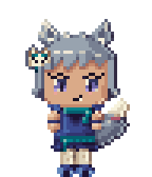
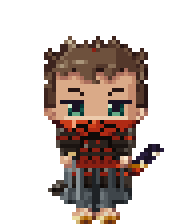
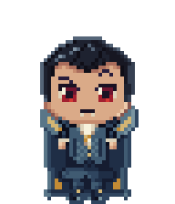
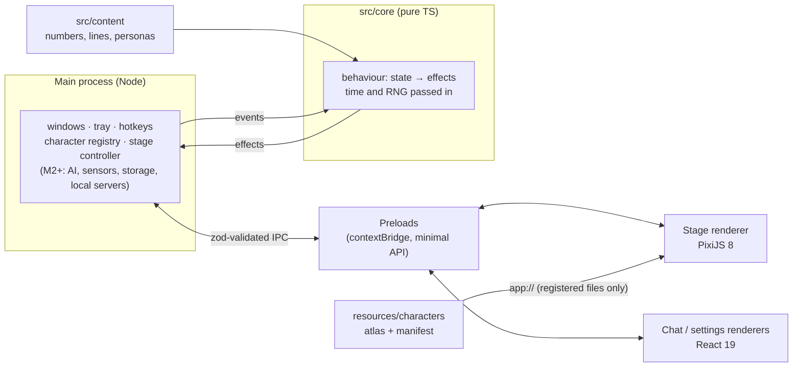

# Pixmates

Original pixel-art desktop companions for Windows. A character lives on top of your windows, walks the taskbar and window edges, and talks in character through an LLM.

[](https://github.com/Oleg-Baltarovych/Pixmates/actions/workflows/ci.yml)
-blue)


## What it is
A Windows 11 app that puts one pixel-art character (switchable) on a transparent, click-through overlay. In v1 the character:
- walks the taskbar and window edges, and reacts to the cursor;
- notices CPU, battery and fullscreen, and keeps quiet when you focus;
- runs focus timers and reminders;
- answers in character through an LLM (local Ollama, Claude, or any OpenAI-compatible model) with read-only system tools;
- reacts to Claude Code sessions through local hooks and an MCP server.

**Status: M0 and M-ART are done; M1 is next.** Today the app runs the hardened overlay and shows the chosen character in idle. It does not walk or talk yet.

| Milestone | Scope | |
|---|---|---|
| M0 | Scaffold, typed IPC, hardening, CI, perf harness, spikes (overlay, RAM/CPU, SQLite, GPU transparency) | done |
| M-ART | Palette, rig, 16 animations, all 8 characters, FX atlas, stage loads packs | done |
| M1 | Behaviour core: state machine, physics, window surfaces, cursor, drag/fling, sleep, tray, character switch | next |
| M2 | AI: 3 providers, `{say, emotion, action}` replies, tools, memory, token budget, evals | |
| M3 | Sensors, quiet mode, throttled reactions, Pomodoro, reminders | |
| M4 | Dev companion: Claude Code hooks, MCP server, git/CI | |
| M5 | Pack import, settings, uk/en | |
| M6 | NSIS installer, auto-update, e2e smoke, release | |

The spec ([`docs/SPEC.md`](docs/SPEC.md), Ukrainian) is the source of truth.

## The cast
Eight original characters, four female and four male. They are not fan art and are not based on existing franchises ([ADR 005](docs/adr/005-original-characters-only.md)). Personas are drafts until M2.

| | | | |
|:-:|:-:|:-:|:-:|
|  |  |  |  |
| **maid**<br>Demon housekeeper with horns and an apron. A strict perfectionist, secretly caring. | **kitsune**<br>Fox-girl ninja. Hyperactive and boastful. | **goth**<br>All in black, long dark hair, lace choker. Calm and ironic. | **witch**<br>Apprentice witch whose spells don't quite work. Unsure, still learning. |
|  |  |  |  |
| **ronin**<br>Samurai in black-and-red lacquered armour, dragon menpō. Calm, speaks in aphorisms. | **coder**<br>Night coder, hood always up. Sleepy, dry humour. The Dev companion's lead. | **knight**<br>Full silver plate; the visor drops when he moves. A noble coward. | **vampire**<br>Aristocratic count with a high fan collar. Theatrical, afraid of light themes and mornings. |

## Art as code
No sprite is drawn by hand: every pixel is generated by TypeScript in [`assets-src/`](assets-src):
- **One rig for all characters**: a 48 × 56 chibi frame, front and three-quarter views, and 16 shared animations. Per-character masks, colour ramps from one master palette and opt-in parts (visor, cloak, collar, tail, mouth mask) give each character its own look.
- **Deterministic builds**: `pnpm sprites` uses seeded hashes and integer maths only. Each generated atlas has a SHA-256 in [`assets-src/sprites.lock.json`](assets-src/sprites.lock.json), and `pnpm test` fails, naming the pack, when one drifts. An intended art change is a reviewed lock diff.
- **Review by eye**: `pnpm sprites:compare <id>` renders before/after sheets against any git ref, on white and on dark. An art-director agent gates every change (≤ 2 rounds), and the owner signs off on the real overlay.
- **These images too**: `pnpm showcase` builds `docs/media/` from the generated packs. It has a small built-in GIF encoder and gives the same bytes on every run.

Rules and catalogue: [`docs/art/ART-BIBLE.md`](docs/art/ART-BIBLE.md) · [`docs/art/RIG.md`](docs/art/RIG.md).

<picture>
  <source media="(prefers-color-scheme: dark)" srcset="docs/media/cast-dark.png">
  
</picture>

## Architecture

- **Pure core** ([ADR 002](docs/adr/002-pure-behavior-core.md)): `src/core` has no Electron, Node, DOM or timers; time and randomness are inputs. Main interprets the effects it returns. Renderers draw and send input, and never decide behaviour.
- **Typed IPC**: every message is a zod contract in [`src/shared/ipc.ts`](src/shared/ipc.ts), validated in main with a sender check.
- **Hardening**: `contextIsolation`, `sandbox`, no `nodeIntegration`, strict CSP, no navigation or `window.open`. Pages load from a custom `app://` protocol, not `file://`. Electron fuses are set at build (RunAsNode off, no extra file-protocol privileges).
- **Performance budget** (SPEC §1, [ADR 007](docs/adr/007-window-strategy.md)): idle < 2 % CPU and ≤ 280 MB private memory, summed over all Electron processes of the packaged build. `pnpm perf` measured every character within budget: **0.25–0.57 % CPU, 213–264 MB**.

Decisions: [`docs/adr/`](docs/adr/README.md) (12 ADRs).

## Engineering practice
- **Plans, review, acceptance.** Non-trivial work starts as a plan in [`docs/plans/`](docs/plans), then implementation, review by the relevant reviewers (code, Electron security, AI, UI, art) and a final QA acceptance against the plan's criteria.
- **AI-assisted, with specialised agents.** Built with Claude Code. Ten agents with narrow roles (architect, lead developer, test writer, persona designer, five read-only reviewers, QA lead), procedures as skills, and hooks that flag core-purity and Electron-hardening violations right after each edit. The setup is committed and described in [`docs/AI-WORKFLOW.md`](docs/AI-WORKFLOW.md).
- **Tests.** 1,042 Vitest tests in 49 files: core, IPC contracts, main-process logic, pack integrity, rig rules and tooling. Core coverage gate ≥ 90 % (currently 100 % lines, 97.6 % branches).
- **CI** on every PR: typecheck (6 TS projects), tests, lint, format, `pnpm audit`, a Windows packaged build with a layout check, and a gitleaks secret scan. Third-party actions are pinned by commit SHA. pnpm blocks dependency build scripts and versions younger than 3 days.

## Getting started
Requirements: Windows 11, Node 24+, pnpm 12.

```sh
pnpm install
pnpm dev                  # build sprites, run with HMR
pnpm check                # typecheck → test → lint → format:check
```

Useful flags (after `pnpm dev --`; in PowerShell, quote comma lists):
```powershell
pnpm dev -- --character=pixmates.knight          # pick a character (default: maid)
pnpm dev -- "--art-lineup=maid,goth,kitsune,witch" # up to 4 side by side, cycling animations
pnpm dev -- --compat-mode                         # software rendering, for GPUs that show black instead of transparency
```

Other commands: `pnpm sprites`, `pnpm sprites:compare <id>`, `pnpm showcase`, `pnpm perf`, `pnpm dist:dir` (unpacked build). In shells that set `ELECTRON_RUN_AS_NODE` (VS Code terminals), unset it before `pnpm dev`.

## License
The code is MIT-licensed ([LICENSE](LICENSE)). The built-in characters' designs, names, personas and lines, including their generated sprites, are original works, all rights reserved (see the exception in [LICENSE](LICENSE)).
